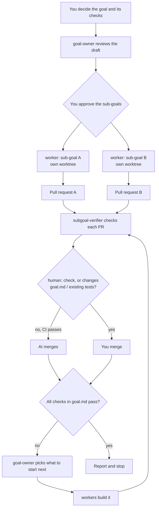

# polaris

```text
                                ____        __            _          .
                               / __ \____  / /___ ______(_)____    --*--
                              / /_/ / __ \/ / __ `/ ___/ / ___/      '
                             / ____/ /_/ / / /_/ / /  / (__  )
                            /_/    \____/_/\__,_/_/  /_/____/
```

Goal Driven Development (GDD) for Claude Code.

You set a goal and the checks that show it is reached. The AI breaks it into sub-goals, builds the independent ones in parallel, and opens a pull request for each. You are called in only when your judgment is needed:

- deciding the goal,
- approving the list of sub-goals,
- merging a pull request that has a `human:` check or changes `goal.md` or existing tests,
- anything hard to reverse (adding a dependency, the data model, an external service).

Everything else the AI merges once CI passes, and you can stop or overturn it at any time.

## Install

In Claude Code:

```
/plugin marketplace add b4tchkn/polaris
/plugin install polaris@polaris
```

## Start

In the repository where you want to get something done (new or existing):

1. `/polaris:gdd-init` — creates `gdd/goal.md` and approval rules in `.claude/settings.json`.
2. Accept the trust prompt for the new rules (restart Claude Code if it does not appear).
3. `/polaris:gdd-loop` — decides the goal with you, then keeps going until every check in it passes.

## How it works



1. **Goal.** You and the AI write `gdd/goal.md`: a north star and 3-5 outcomes, each with a Check. `goal-owner` reviews the draft in a separate context.
2. **Sub-goals.** The rest is split into small sub-goals in `gdd/subgoals/`. You approve the list.
3. **Build.** `worker` agents build independent sub-goals in parallel, each in its own git worktree, and each opens a pull request.
4. **Verify.** `subgoal-verifier` checks that each pull request's Checks really test their conditions.
5. **Merge.** The AI merges once CI passes. You merge when the PR has a `human:` condition or changes `goal.md` or existing tests.
6. **Repeat** until every Check in `goal.md` passes.

## What the plugin adds

- Skills: `/polaris:gdd-init` and `/polaris:gdd-loop`.
- Subagents: `worker` (builds one sub-goal in its own worktree and opens a pull request), `goal-owner` (reviews the goal and picks what to start next), and `subgoal-verifier` (checks that a pull request's checks really test their conditions). The last two work in a context separate from the AI that builds.

The AI replies in the language you use.
